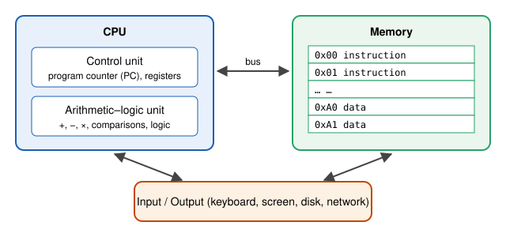

# Introduction: computers, algorithms and Python {#sec-ch-intro}

> *"An algorithm must be seen to be believed."* — Donald E. Knuth,
> *The Art of Computer Programming*, vol. 1 [@knuth1997].

::: {.callout-note}
## Learning objectives
By the end of this chapter you will be able to:

- describe what a computer does, using the **von Neumann model** and the
  fetch–decode–execute cycle;
- explain how numbers are represented with **bits**, convert numbers between
  bases by hand and in code, and **prove** that the representation is unique;
- define an **algorithm**, analyse **Euclid's algorithm** and prove that it is
  correct and fast (Lamé's theorem);
- explain why some problems **cannot** be solved by any program (the halting
  problem);
- use **asymptotic notation** ($O$, $\Omega$, $\Theta$) to compare the cost of
  algorithms, and prove the basic facts about it;
- explain what Python is, how **CPython** executes your code, and set up a
  **development environment** (REPL, scripts, VS Code, Jupyter, Colab).
:::

::: {.callout-tip}
## Course lessons covered
1.1 *Introduction to the course* · 1.2 *Computer programming* · 1.3 *The
development environment*.
:::

## Intuition: a very fast, very literal cook

Imagine a cook who is extraordinarily fast — billions of operations per
second — but who has **no common sense at all**. The cook can only follow a
written recipe, one line at a time, exactly as written. If the recipe says
"add salt" without saying how much, the cook stops. If the recipe says "stir
until ready" without saying what "ready" means, the cook stirs forever.

A **computer** is that cook. A **program** is the recipe. An **algorithm** is
the *idea* behind the recipe — the method, independent of the language in
which it is written (Italian, English, Python). **Programming** is the art of
writing recipes so precise that a literal-minded machine can execute them, and
so clear that a human can read, check and modify them.

This chapter builds the vocabulary for that art: what the machine is (§
[-@sec-von-neumann]), how it represents information (§ [-@sec-bits]), what an
algorithm is and how we prove it right (§ [-@sec-algorithms]), what can never
be computed (§ [-@sec-halting]), how we measure the cost of an algorithm
(§ [-@sec-asymptotic]), and finally what Python is and how to start using it
(§ [-@sec-python-language] and § [-@sec-dev-environment]).

## What a computer is: the von Neumann model {#sec-von-neumann}

In June 1945 John von Neumann circulated the *First Draft of a Report on the
EDVAC* [@vonneumann1945], a description of a computer in which **the program is
stored in the same memory as the data**. This *stored-program* idea, which
grew out of the work of the ENIAC team (J. Presper Eckert and John Mauchly)
and was anticipated in theory by Alan Turing's universal machine
[@turing1936], is still the blueprint of almost every computer today.

{#fig-von-neumann width=80%}

The model has four parts (@fig-von-neumann):

1. **Memory** — a long sequence of numbered cells. Each cell holds a fixed
   number of bits (today: 8 bits = 1 **byte**) and is identified by its
   **address**, a natural number $0, 1, 2, \dots$
2. **Central processing unit (CPU)**, made of
   - the **control unit**, which decides what to do next, and
   - the **arithmetic–logic unit (ALU)**, which performs operations such as
     addition and comparison;
   - a few very fast storage cells called **registers**, including the
     **program counter** (PC), which holds the address of the next
     instruction.
3. **Input/output (I/O)** devices — keyboard, screen, disk, network.
4. A **bus** connecting them.

The CPU runs one loop, forever, called the **fetch–decode–execute cycle**:

```text
repeat forever:
    instruction ← memory[PC]        # fetch
    PC ← PC + size(instruction)     # point to the next one
    decode instruction              # which operation? which operands?
    execute instruction             # may read/write memory, or change PC (a jump)
```

Everything a computer does — playing a video, training a neural network —
is a (very long) sequence of iterations of this loop. A *jump* instruction,
which overwrites the PC, is what makes decisions (§ [-@sec-ch-conditionals])
and repetition (§ [-@sec-ch-loops]) possible.

::: {.callout-tip}
## Why "stored program" matters
Because programs are just data in memory, a program can **read, write or
generate other programs**. That is exactly what a compiler, an interpreter
such as Python, or a large language model that writes code
(§ [-@sec-ch-ai-tools]) does.
:::

## Information as bits {#sec-bits}

### Why binary?

Electronic circuits distinguish two voltage levels very reliably (say, "low"
and "high") much more cheaply than ten. Claude Shannon showed in his 1937
master's thesis that circuits of switches implement **Boolean algebra**
[@shannon1938], and in 1948 he introduced the word **bit** (*binary digit*,
a term he credits to John W. Tukey) as the unit of information
[@shannon1948]. A bit has two values, written $0$ and $1$.

How many different things can $n$ bits represent?

::: {#thm-bit-strings}
## Counting bit strings
There are exactly $2^n$ distinct strings of $n$ bits.
:::

*In one line:* each additional bit doubles the number of possibilities.

::: {.callout-caution collapse="true"}
## For the interested reader — proof of @thm-bit-strings

By induction on $n$.

*Base case* $n=0$: there is exactly one string of length $0$ (the empty
string), and $2^0 = 1$.

*Inductive step*: assume there are $2^n$ strings of length $n$. Every string of
length $n+1$ is obtained, in exactly one way, by appending either $0$ or $1$ to
a string of length $n$. Hence there are $2^n + 2^n = 2^{n+1}$ of them.
$\blacksquare$
:::

So one byte (8 bits) has $2^8 = 256$ values, enough to number the
integers $0,\dots,255$; 64 bits give $2^{64} \approx 1.8\times 10^{19}$ values.

### Positional notation

We write numbers in **base 10**: the string "$2026$" means
$2\cdot10^3 + 0\cdot 10^2 + 2\cdot 10^1 + 6\cdot 10^0$. Nothing is special
about 10 — it is the number of our fingers. In general:

::: {#def-positional}
## Base-$b$ representation
Let $b \ge 2$ be an integer (the **base**). A string of **digits**
$d_{k-1} d_{k-2} \dots d_1 d_0$ with each $d_i \in \{0, 1, \dots, b-1\}$
represents the natural number
$$
n = \sum_{i=0}^{k-1} d_i\, b^{i}.
$$ {#eq-positional}
:::

We write $(d_{k-1}\dots d_0)_b$ when the base must be explicit. Base 2 is
**binary**, base 8 **octal**, base 16 **hexadecimal** (digits
$0$–$9$ then $\mathtt{A}=10,\dots,\mathtt{F}=15$).

::: {#exm-binary-13}
## Reading a binary number
$(1101)_2 = 1\cdot 2^3 + 1\cdot 2^2 + 0 \cdot 2^1 + 1\cdot 2^0 = 8+4+0+1 = 13.$

$(\mathtt{FF})_{16} = 15\cdot 16 + 15 = 255$, which is also $(11111111)_2$:
one byte with all bits set.
:::

Two questions arise immediately. Does **every** natural number have a base-$b$
representation? And is it **unique** — could the same number have two
different digit strings? We need one tool first.

::: {#lem-division}
## Euclidean division
For every integer $a$ and every integer $b > 0$ there exist **unique**
integers $q$ (the *quotient*) and $r$ (the *remainder*) such that
$$
a = q\,b + r, \qquad 0 \le r < b.
$$
We write $q = \lfloor a/b \rfloor$ and $r = a \bmod b$.
:::

*In one line:* you can always divide and get a remainder smaller than the
divisor, and only one such pair $(q, r)$ exists.

::: {.callout-caution collapse="true"}
## For the interested reader — proof of @lem-division

*Existence.* Consider the set $S = \{a - qb : q \in \mathbb{Z},\ a - qb \ge 0\}$.
It is non-empty (take $q = -\lvert a\rvert$: then
$a - qb = a + \lvert a\rvert b \ge a + \lvert a\rvert \ge 0$ because $b \ge 1$).
By the **well-ordering principle** (every non-empty set of natural numbers has a
smallest element) $S$ has a smallest element $r = a - qb \ge 0$. If we had
$r \ge b$, then $r - b = a - (q+1)b \ge 0$ would be a smaller element of $S$,
a contradiction. So $0 \le r < b$.

*Uniqueness.* Suppose $a = qb + r = q'b + r'$ with $0 \le r, r' < b$. Then
$(q - q')\,b = r' - r$. The right-hand side satisfies $-b < r'-r < b$, and the
only multiple of $b$ strictly between $-b$ and $b$ is $0$. Hence $r = r'$ and
$q = q'$. $\blacksquare$
:::

In Python, `a // b` computes $q$ and `a % b` computes $r$ — and, unlike in C or
Java, Python keeps $0 \le r < b$ **also when $a$ is negative**
(`-7 // 2 == -4` and `-7 % 2 == 1`, because $-7 = (-4)\cdot 2 + 1$). We will
come back to this in @sec-ch-variables.

::: {#thm-base-representation}
## Existence and uniqueness of the base-$b$ representation
Let $b\ge 2$. Every natural number $n \ge 1$ has exactly one representation
$(d_{k-1}\dots d_0)_b$ with $d_{k-1} \neq 0$ (no leading zeros). Moreover the
number of digits is
$$
k = \lfloor \log_b n \rfloor + 1.
$$ {#eq-num-digits}
:::

*In one line:* repeatedly dividing by $b$ produces the digits, from the last
to the first, and there is no other choice.

::: {.callout-caution collapse="true"}
## For the interested reader — proof of @thm-base-representation

*Existence*, by strong induction on $n$. If $1 \le n < b$, the one-digit string
$(n)_b$ works. If $n \ge b$, divide (@lem-division): $n = q b + r$ with
$0 \le r < b$ and $q = \lfloor n/b \rfloor$. Since $n \ge b$, $q \ge 1$; since
$b \ge 2$, $q \le n/2 < n$. By the induction hypothesis $q$ has a
representation $(e_{m-1}\dots e_0)_b$ with $e_{m-1}\neq0$. Then
$$
n = q b + r = \Big(\sum_{i=0}^{m-1} e_i b^i\Big) b + r = \sum_{i=0}^{m-1} e_i b^{i+1} + r\, b^0,
$$
i.e. $n = (e_{m-1}\dots e_0\, r)_b$: we have appended the digit $r$.

*Uniqueness*, again by strong induction. Suppose
$n = \sum_{i=0}^{k-1} d_i b^i = \sum_{i=0}^{k'-1} d'_i b^i$. Write the first sum
as $\big(\sum_{i\ge1} d_i b^{i-1}\big)\, b + d_0$ with $0 \le d_0 < b$: by the
uniqueness in @lem-division, $d_0 = n \bmod b$, and likewise $d'_0 = n\bmod b$.
So $d_0 = d'_0$, and the two numbers $\sum_{i\ge1} d_i b^{i-1}$ and
$\sum_{i\ge 1} d'_i b^{i-1}$ are both equal to $\lfloor n/b\rfloor < n$. By the
induction hypothesis their representations coincide (if
$\lfloor n/b\rfloor = 0$ both strings are empty, because there are no leading
zeros). Hence the two representations of $n$ are identical.

*Number of digits.* If $d_{k-1} \ne 0$ then
$b^{k-1} \le d_{k-1}b^{k-1} \le n$, and
$n \le \sum_{i=0}^{k-1}(b-1)b^i = b^k - 1 < b^k$ (a telescoping sum). So
$b^{k-1} \le n < b^k$; taking $\log_b$, which is increasing,
$k-1 \le \log_b n < k$, i.e. $k - 1 = \lfloor \log_b n\rfloor$.
$\blacksquare$
:::

The existence proof *is* an algorithm: **repeated division**. The remainders,
read from last to first, are the digits.

::: {#exm-to-binary}
## 13 in binary, by hand

| step | $n$ | $n \,/\!/\, 2$ | $n \bmod 2$ (digit) |
|---|---|---|---|
| 1 | 13 | 6 | **1** ($d_0$) |
| 2 | 6 | 3 | **0** ($d_1$) |
| 3 | 3 | 1 | **1** ($d_2$) |
| 4 | 1 | 0 | **1** ($d_3$) |

Reading the last column from bottom to top: $13 = (1101)_2$. Check with
@eq-num-digits: $\lfloor \log_2 13 \rfloor + 1 = \lfloor 3.70\rfloor + 1 = 4$
digits. ✓
:::

::: {#exm-hex}
## 2026 in hexadecimal
$2026 = 126\cdot 16 + 10$ → digit $\mathtt{A}$;
$126 = 7\cdot 16 + 14$ → digit $\mathtt{E}$;
$7 = 0 \cdot 16 + 7$ → digit $7$. So $2026 = (\mathtt{7EA})_{16}$.
Check: $7\cdot256 + 14\cdot 16 + 10 = 1792 + 224 + 10 = 2026$. ✓
:::

Hexadecimal is popular among programmers because one hex digit corresponds to
exactly 4 bits ($16 = 2^4$), so a byte is exactly two hex digits:
$\mathtt{7EA}_{16} = \underbrace{0111}_{7}\,\underbrace{1110}_{E}\,\underbrace{1010}_{A}$.

#### Try it yourself {.unnumbered}

::: {.widget}
```{ojs}
//| echo: false
viewof nConv = Inputs.range([1, 100000], {step: 1, value: 2026, label: "Number n"})
viewof bConv = Inputs.range([2, 16], {step: 1, value: 2, label: "Base b"})
```

```{ojs}
//| echo: false
convSteps = {
  const digits = "0123456789ABCDEF";
  let n = nConv, rows = [];
  while (n > 0) {
    rows.push({n: n, q: Math.floor(n / bConv), r: n % bConv, digit: digits[n % bConv]});
    n = Math.floor(n / bConv);
  }
  return rows;
}
html`<p>Repeated division of <b>${nConv}</b> by <b>${bConv}</b>:</p>
<table class="table table-sm"><thead><tr><th>n</th><th>n // b</th><th>n mod b</th></tr></thead>
<tbody>${convSteps.map(s => html`<tr><td>${s.n}</td><td>${s.q}</td><td>${s.r} → <b>${s.digit}</b></td></tr>`)}</tbody></table>
<p>Result (read the digits bottom-up): <code>(${convSteps.map(s => s.digit).reverse().join("")})<sub>${bConv}</sub></code>
— ${convSteps.length} digits; formula ⌊log<sub>b</sub> n⌋ + 1 = ${Math.floor(Math.log(nConv) / Math.log(bConv) + 1e-12) + 1}.</p>`
```
:::

### Practice: base conversion in Python

Python has built-in conversions — `bin`, `oct`, `hex` and `int(text, base)` —
but writing our own is the best way to check that we understood the theorem.

```{python}
def to_base(n: int, b: int) -> str:
    """Return the base-b representation of n >= 0 (2 <= b <= 16).

    Implements the existence proof of the base-b theorem:
    the last digit is n % b, the others are the representation of n // b.
    """
    digits = "0123456789ABCDEF"
    if n == 0:
        return "0"
    out = []
    while n > 0:
        n, r = divmod(n, b)   # Euclidean division: n = q*b + r
        out.append(digits[r])
    return "".join(reversed(out))  # remainders come out last-digit-first

def from_base(s: str, b: int) -> int:
    """Evaluate a digit string in base b using Horner's rule."""
    value = 0
    for ch in s:
        value = value * b + int(ch, 16)   # shift left one position, add the digit
    return value

for n in [13, 255, 2026]:
    print(n, to_base(n, 2), to_base(n, 16), "| built-ins:", bin(n), hex(n))

print(from_base("1101", 2), from_base("7EA", 16), int("7EA", 16))
```

`from_base` uses **Horner's rule** [@horner1819]: instead of computing each
power $b^i$, it rewrites @eq-positional as
$$
n = (\cdots((d_{k-1}\,b + d_{k-2})\,b + d_{k-3})\,b + \cdots)\,b + d_0,
$$
which needs only $k-1$ multiplications. For example
$(1101)_2 = ((1\cdot2+1)\cdot2+0)\cdot2+1 = 13$.

## Algorithms {#sec-algorithms}

### What an algorithm is

The word comes from the name of the 9th-century Persian mathematician
Muḥammad ibn Mūsā **al-Khwārizmī**, whose book on calculating with
Hindu–Arabic numerals introduced positional arithmetic to Europe. Knuth
[@knuth1997, §1.1] gives the definition used by computer scientists:

::: {#def-algorithm}
## Algorithm (Knuth)
An **algorithm** is a finite set of rules that gives a sequence of operations
for solving a specific type of problem, and has five properties:

1. **Finiteness** — it always terminates after a finite number of steps;
2. **Definiteness** — each step is precisely and unambiguously defined;
3. **Input** — it has zero or more inputs, taken from specified sets;
4. **Output** — it has one or more outputs, with a specified relation to the
   inputs;
5. **Effectiveness** — each operation is basic enough to be carried out
   exactly, in principle by a person with pencil and paper, in finite time.
:::

A **program** is an algorithm written in a programming language; a program may
also *fail* to be an algorithm (for instance, it can loop forever — it violates
finiteness).

To claim that an algorithm *works* we must prove two things:

- **partial correctness**: *if* it terminates, the output is right;
- **termination**: it does terminate, on every valid input.

Together they give **total correctness**. Let us do this for the oldest
non-trivial algorithm still in daily use.

### Euclid's algorithm

The **greatest common divisor** $\gcd(a,b)$ of two natural numbers, not both
zero, is the largest integer dividing both. It is needed, for example, to reduce
fractions ($\tfrac{252}{105} = \tfrac{12}{5}$ because $\gcd(252,105)=21$) and
is at the heart of the RSA cryptosystem.

The naive method — try every candidate $d = \min(a,b), \min(a,b)-1, \dots$ —
needs up to $\min(a,b)$ divisions. Euclid's *Elements* (c. 300 BC, Book VII,
Propositions 1–2) contains a dramatically better method, based on one
observation:

::: {#lem-gcd-step}
## The key step
For integers $a \ge 0$ and $b > 0$: $\gcd(a, b) = \gcd(b,\ a \bmod b)$.
:::

*In one line:* $a$ and $b$ have exactly the same common divisors as $b$ and
$a \bmod b$.

::: {.callout-caution collapse="true"}
## For the interested reader — proof of @lem-gcd-step

Let $r = a \bmod b$, so $a = qb + r$ (@lem-division). If $d$ divides $a$ and
$b$, then $d$ divides $a - qb = r$; so $d$ divides $b$ and $r$. Conversely, if
$d$ divides $b$ and $r$, then $d$ divides $qb + r = a$. Hence the set of
common divisors of $(a,b)$ equals the set of common divisors of $(b, r)$, and
in particular their largest elements coincide. $\blacksquare$
:::

Since $\gcd(a, 0) = a$ (every number divides $0$), we obtain:

```text
Euclid(a, b):            # a >= 0, b >= 0, not both zero
    while b != 0:
        a, b = b, a mod b
    return a
```

::: {#exm-euclid}
## $\gcd(252, 105)$ by hand

| $a$ | $b$ | $a \bmod b$ |
|---|---|---|
| 252 | 105 | 42 |
| 105 | 42 | 21 |
| 42 | 21 | 0 |
| 21 | 0 | — |

Answer: $21$. Three divisions instead of up to 105.
:::

::: {#thm-euclid-correct}
## Total correctness of Euclid's algorithm
For all $a, b \ge 0$ not both zero, `Euclid(a, b)` terminates and returns
$\gcd(a, b)$.
:::

*In one line:* the gcd never changes along the loop (an *invariant*), and $b$
strictly decreases, so the loop must stop.

::: {.callout-caution collapse="true"}
## For the interested reader — proof of @thm-euclid-correct

Let $(a_0,b_0) = (a,b)$ and $(a_{i+1}, b_{i+1}) = (b_i,\ a_i \bmod b_i)$ be the
values after each iteration.

*Invariant.* $\gcd(a_i,b_i) = \gcd(a,b)$ for every $i$. True for $i=0$; and if
true for $i$, then by @lem-gcd-step
$\gcd(a_{i+1},b_{i+1}) = \gcd(b_i, a_i \bmod b_i) = \gcd(a_i,b_i)$.

*Termination.* For $i \ge 0$ with $b_i > 0$,
$b_{i+1} = a_i \bmod b_i < b_i$. A strictly decreasing sequence of natural
numbers cannot be infinite (it would have no smallest element, contradicting
well-ordering), so eventually $b_k = 0$.

*Output.* When the loop stops, $b_k = 0$ and the algorithm returns
$a_k = \gcd(a_k, 0) = \gcd(a_k, b_k) = \gcd(a, b)$ by the invariant.
$\blacksquare$
:::

This proof pattern — **an invariant that is preserved, plus a quantity that
strictly decreases** — is the standard way to prove loops correct. We will
formalise it in @sec-loop-invariants.

### How fast is Euclid? Lamé's theorem

Termination says the loop stops; it does not say *when*. In 1844 Gabriel Lamé
proved that the worst case is related to the **Fibonacci numbers**
$F_0 = 0, F_1 = 1, F_{n} = F_{n-1} + F_{n-2}$, i.e.
$0, 1, 1, 2, 3, 5, 8, 13, 21, \dots$ [@lame1844; @knuth1997b, §4.5.3].

::: {#thm-lame}
## Lamé's theorem
If $a > b \ge 1$ and Euclid's algorithm performs $k \ge 1$ divisions, then
$b \ge F_{k+1}$ and $a \ge F_{k+2}$. Consequently, the number of divisions is
at most about $\log_\varphi b + 1 \approx 1.44\,\log_2 b + 1$, where
$\varphi = \frac{1+\sqrt5}{2} \approx 1.618$ is the golden ratio.
:::

*In one line:* to force many steps you need large numbers — growing at least
like Fibonacci numbers — so the number of steps grows only with the number of
*digits* of $b$.

::: {.callout-caution collapse="true"}
## For the interested reader — proof of @thm-lame

*Part 1, by induction on $k$.* If $k = 1$: $b \ge 1 = F_2$, and $a > b$ gives
$a \ge 2 = F_3$. Suppose the claim holds for $k-1 \ge 1$ divisions, and let
$(a,b)$ require $k$ divisions. The first division turns $(a,b)$ into
$(b, r)$ with $r = a \bmod b$, which then requires $k-1 \ge 1$ divisions; so
$r \ge 1$ and $b > r$, and by the hypothesis $b \ge F_{k+1}$ and $r \ge F_k$.
Since $a > b$, the quotient is $q = \lfloor a/b\rfloor \ge 1$, so
$a = qb + r \ge b + r \ge F_{k+1} + F_{k} = F_{k+2}$.

*Part 2: Fibonacci numbers grow exponentially.* We show
$F_n \ge \varphi^{n-2}$ for all $n \ge 1$. The golden ratio satisfies
$\varphi^2 = \varphi + 1$ (check: $\varphi^2 = \frac{6 + 2\sqrt5}{4} = \frac{3+\sqrt5}{2} = \varphi + 1$).
For $n = 1$: $F_1 = 1 \ge \varphi^{-1}\approx 0.618$. For $n = 2$:
$F_2 = 1 = \varphi^{0}$. For $n \ge 3$, by strong induction,
$F_n = F_{n-1} + F_{n-2} \ge \varphi^{n-3} + \varphi^{n-4} = \varphi^{n-4}(\varphi + 1) = \varphi^{n-4}\varphi^2 = \varphi^{n-2}.$

*Conclusion.* With $k$ divisions, $b \ge F_{k+1} \ge \varphi^{k-1}$, hence
$k \le \log_\varphi b + 1$. Since $\log_\varphi b = \log_2 b / \log_2\varphi$
and $1/\log_2 \varphi \approx 1.4404$, we get $k \le 1.4404 \log_2 b + 1$.
$\blacksquare$
:::

So for two 100-digit numbers ($b < 10^{100}$, $\log_2 b < 333$) Euclid needs
at most about $480$ divisions, while the naive method could need $10^{100}$.
The worst case is attained by consecutive Fibonacci numbers, as the code
below confirms.

```{python}
def gcd_trace(a: int, b: int) -> tuple[int, int]:
    """Euclid's algorithm. Returns (gcd, number of divisions performed)."""
    steps = 0
    while b != 0:
        a, b = b, a % b   # Lemma: gcd(a, b) = gcd(b, a mod b)
        steps += 1
    return a, steps

print(gcd_trace(252, 105))           # the worked example: (21, 3)

# Consecutive Fibonacci numbers are the worst case of Lamé's theorem
fib = [0, 1]
while len(fib) < 40:
    fib.append(fib[-1] + fib[-2])
for k in [5, 10, 20, 28]:
    a, b = fib[k + 2], fib[k + 1]
    print(f"gcd(F{k+2}={a}, F{k+1}={b}) -> divisions:", gcd_trace(a, b)[1])

import math
print(math.gcd(252, 105))            # the standard library already has it
```

With $(a,b) = (F_{k+2}, F_{k+1})$ the algorithm performs exactly $k$ divisions,
so the bound of @thm-lame is tight.

## What cannot be computed: the halting problem {#sec-halting}

Is there any limit to what algorithms can do? In 1936, in the paper that
introduced what we now call **Turing machines**, Alan Turing proved that some
perfectly well-defined problems have **no** algorithm at all [@turing1936].
(Alonzo Church reached an equivalent result the same year with the
$\lambda$-calculus [@church1936].) The most famous is:

> **The halting problem.** Given the source code of a program $P$ and an input
> $x$, decide whether $P$ eventually stops when run on $x$.

::: {#thm-halting}
## Turing, 1936
No program `halts(P, x)` can return `True` exactly when program $P$ halts on
input $x$, and `False` otherwise, for **all** programs $P$ and inputs $x$.
:::

*In one line:* if such a program existed, we could build a program that does
the opposite of what `halts` predicts about itself.

::: {.callout-caution collapse="true"}
## For the interested reader — proof of @thm-halting (diagonalisation)

Suppose, for contradiction, that `halts` exists and always answers correctly.
Since programs are strings (stored-program idea!), a program can be given its
own source as input. Define

```python
def trouble(P):
    if halts(P, P):      # would P stop when fed its own code?
        while True:      # ... then loop forever
            pass
    else:
        return           # ... otherwise stop immediately
```

Now ask: does `trouble` halt on input `trouble`?

- If `halts(trouble, trouble)` returns `True`, then `trouble(trouble)` enters
  the infinite loop, i.e. it does **not** halt — so `halts` was wrong.
- If it returns `False`, then `trouble(trouble)` returns immediately, i.e. it
  **does** halt — so `halts` was wrong again.

Either way `halts` gives a wrong answer on the input
`(trouble, trouble)`, contradicting the assumption. $\blacksquare$

The technique, *diagonalisation*, goes back to Georg Cantor's 1891 proof that
the real numbers cannot be listed.
:::

::: {.callout-important}
## Why an engineer should care
There can be no perfect tool that, for every program, tells you whether it
contains an infinite loop — and, by a generalisation called **Rice's theorem**
[@rice1953], no perfect tool that decides *any* non-trivial property of what
programs do. Linters, type checkers, test suites and AI code reviewers
(§ [-@sec-ch-ai-tools]) are therefore always **approximations**. Verifying code
remains part of your job.
:::

## Measuring cost: asymptotic notation {#sec-asymptotic}

To compare algorithms we count **basic operations** (comparisons, additions,
memory accesses) as a function of the **input size** $n$, and we care about
how this count grows when $n$ is large. Constant factors depend on the
machine; the *growth rate* does not. The notation below was introduced by Paul
Bachmann (1894) and Edmund Landau (1909) in number theory and adapted to
algorithms by Knuth [@knuth1976].

::: {#def-big-o}
## $O$, $\Omega$, $\Theta$
Let $f, g: \mathbb{N} \to \mathbb{R}_{\ge 0}$.

- $f = O(g)$ (" $f$ is *big-O* of $g$ ") if there are constants $c > 0$ and
  $n_0$ such that $f(n) \le c\, g(n)$ for all $n \ge n_0$. *(Upper bound.)*
- $f = \Omega(g)$ if there are $c > 0$, $n_0$ such that
  $f(n) \ge c\, g(n)$ for all $n\ge n_0$. *(Lower bound.)*
- $f = \Theta(g)$ if $f = O(g)$ and $f = \Omega(g)$. *(Same growth.)*
:::

The "$=$" is a traditional abuse of notation: $O(g)$ is really a *set* of
functions and $f = O(g)$ means $f \in O(g)$.

::: {#exm-theta-poly}
## A quadratic function
Let $f(n) = 3n^2 + 5n + 2$. For $n\ge 1$ we have $5n \le 5n^2$ and
$2 \le 2n^2$, so $f(n) \le 10n^2$: thus $f = O(n^2)$ with $c=10, n_0=1$. Also
$f(n) \ge 3n^2$ for all $n$, so $f = \Omega(n^2)$. Hence $f = \Theta(n^2)$.
The lower-order terms and the constant 3 do not matter.
:::

The facts below are used constantly; each follows directly from the
definition.

::: {#thm-big-o-rules}
## Rules of asymptotic notation
For non-negative functions:

1. (*Constants*) $c \cdot f = \Theta(f)$ for every constant $c > 0$.
2. (*Sum*) $f + g = \Theta(\max(f,g))$.
3. (*Transitivity*) if $f = O(g)$ and $g = O(h)$ then $f = O(h)$.
4. (*Polynomials*) if $p(n) = a_d n^d + \dots + a_0$ with $a_d > 0$, then
   $p = \Theta(n^d)$.
5. (*Logarithms*) for bases $a, b > 1$: $\log_a n = \Theta(\log_b n)$, so we
   write simply $\log n$.
6. (*Polynomial vs exponential*) for every $k \ge 0$ and $c > 1$:
   $n^k = O(c^n)$, but $c^n \ne O(n^k)$.
:::

*In one line:* keep only the fastest-growing term, ignore constants and the
base of logarithms; exponentials beat every polynomial.

::: {.callout-caution collapse="true"}
## For the interested reader — proof of @thm-big-o-rules

1. $c f(n) \le c\cdot f(n)$ and $c f(n) \ge c\cdot f(n)$: take the constant $c$
   in both definitions.
2. $\max(f,g) \le f + g \le 2\max(f,g)$.
3. $f(n) \le c_1 g(n)$ for $n \ge n_1$ and $g(n) \le c_2 h(n)$ for
   $n \ge n_2$ give $f(n) \le c_1 c_2 h(n)$ for $n \ge \max(n_1,n_2)$.
4. Let $A = \sum_{i<d} \lvert a_i\rvert$. For $n \ge 1$,
   $p(n) \le a_d n^d + A n^{d-1} \le (a_d + A)n^d$. For the lower bound,
   $p(n) \ge a_d n^d - A n^{d-1} = n^{d-1}(a_d n - A) \ge \tfrac{a_d}{2} n^d$
   as soon as $a_d n - A \ge \tfrac{a_d}{2}n$, i.e. $n \ge 2A/a_d$.
5. Change of base: $\log_a n = \dfrac{\log_b n}{\log_b a}$, and
   $1/\log_b a$ is a positive constant; apply rule 1.
6. Let $u_n = n^k / c^n$ for $n\ge1$. Then
   $\dfrac{u_{n+1}}{u_n} = \dfrac{(1 + 1/n)^k}{c}$. Since $(1+1/n)^k \to 1$
   as $n \to \infty$, there is $n_0$ such that the ratio is at most
   $\rho := \frac{1 + c}{2c} < 1$ for $n \ge n_0$. Hence $u_n$ is
   non-increasing from $n_0$ on, so $u_n \le u_{n_0}$, i.e.
   $n^k \le u_{n_0}\, c^n$ for $n \ge n_0$. If we also had $c^n \le C n^k$ for
   large $n$, then $u_n \ge 1/C$; but $u_n \le u_{n_0}\rho^{\,n-n_0} \to 0$, a
   contradiction. $\blacksquare$
:::

The most common growth rates, from best to worst:

| Name | $g(n)$ | Typical example (this book) | $n = 10^6$: operations |
|---|---|---|---|
| constant | $1$ | index a list, look up a dict key | $1$ |
| logarithmic | $\log n$ | binary search (§ [-@sec-binary-search]), Euclid | $\approx 20$ |
| linear | $n$ | scan a list | $10^6$ |
| linearithmic | $n\log n$ | sorting (§ [-@sec-sorting]) | $\approx 2\times10^7$ |
| quadratic | $n^2$ | all pairs of elements | $10^{12}$ |
| exponential | $2^n$ | all subsets | more than atoms in the universe |

```{ojs}
//| echo: false
viewof nMax = Inputs.range([4, 64], {step: 1, value: 30, label: "max n"})
growthData = {
  const fs = [["log2 n", n => Math.log2(n)], ["n", n => n], ["n log2 n", n => n*Math.log2(n)],
              ["n^2", n => n*n], ["2^n", n => 2**n]];
  const out = [];
  for (let n = 2; n <= nMax; n++) for (const [name, f] of fs) out.push({n, name, value: f(n)});
  return out;
}
```

```{ojs}
//| echo: false
//| label: fig-growth
//| fig-cap: "Growth of common cost functions (logarithmic vertical axis). Drag the slider to change the range of n."
Plot.plot({y: {type: "log", label: "operations"}, color: {legend: true},
  marks: [Plot.line(growthData, {x: "n", y: "value", stroke: "name"})]})
```

## Programming languages and Python {#sec-python-language}

### From machine code to high-level languages

The CPU understands only **machine code**: binary-encoded instructions such as
"add register 1 to register 2". Writing programs directly in it is extremely
error-prone. The history of programming languages is the history of
increasingly **abstract** notations, translated automatically into machine
code:

- **assembly** languages (late 1940s) give names to instructions (`ADD R1, R2`);
- **FORTRAN** (John Backus' team at IBM, 1957) let scientists write formulas;
- **C** (Dennis Ritchie, 1972) became the language of operating systems;
- **Python** (Guido van Rossum, first released in February 1991) aimed at
  readability and productivity [@vanrossum2009].

A translator can work in two ways:

- a **compiler** translates the whole program, ahead of time, into machine code
  (C, Rust, Go);
- an **interpreter** reads the program and executes it directly, statement by
  statement.

Python's reference implementation, **CPython** (written in C), is a mix: it
first **compiles** your source code into a compact intermediate code called
**bytecode**, then a **virtual machine** — a fetch–decode–execute loop written
in software, exactly like @sec-von-neumann but one level up — **interprets**
the bytecode. The `dis` module lets us look at it:

```{python}
import dis

def area(width, height):
    return width * height

dis.dis(area)   # disassemble: show the bytecode instructions of the function
```

Each line is one instruction of the Python virtual machine: load the two
arguments onto a stack, multiply, return. You will never need to write
bytecode, but knowing that it exists explains, for instance, why Python is
slower than C for tight numeric loops (each bytecode instruction costs many
machine instructions) and why libraries such as NumPy (§
[-@sec-crash-courses]) move heavy computations into compiled code.

### Why Python, and why for AI?

Python's design philosophy is summarised in *The Zen of Python* [@pep20],
which you can read by typing `import this`. Three lines capture it:
*"Beautiful is better than ugly"*, *"Readability counts"*, *"There should be
one — and preferably only one — obvious way to do it"*. Python became the
language of data science and AI because it combines a **readable syntax**,
**interactive** use (ideal for experimentation), and **bindings to fast
compiled libraries** (NumPy, PyTorch, TensorFlow) — you write the logic in
Python, the heavy arithmetic runs in C, C++ or CUDA.

Python evolves through **PEPs** (*Python Enhancement Proposals*), public design
documents numbered sequentially: PEP 8 is the style guide [@pep8], PEP 20 the
Zen, PEP 484 introduced type hints. We will cite PEPs often; @sec-finding-sources
explains how to read them. Python 2 reached end-of-life on 1 January 2020;
**this book uses Python 3** (version 3.13).

## The development environment {#sec-dev-environment}

A **development environment** is the set of tools you use to write, run and
debug programs. You need at least: a Python **interpreter**, a place to
**write** code, and a way to **run** it.

### Installing Python

- **Windows / macOS**: download the installer from
  <https://www.python.org/downloads/>. On Windows, tick *"Add python.exe to
  PATH"*. The installer also provides the `py` launcher (§
  [-@sec-python-versions]).
- **Linux**: Python 3 is usually pre-installed; otherwise use the
  distribution's package manager (e.g. `sudo apt install python3`).

Check the installation from a **terminal** (macOS: *Terminal*; Windows:
*PowerShell*):

```bash
python3 --version     # on Windows: py --version
```

### The interactive interpreter (REPL) {#sec-repl}

Typing `python3` (or `py`) with no arguments starts the **REPL**
(*Read–Eval–Print Loop*, a term from the Lisp tradition): it **reads** an
expression, **evaluates** it, **prints** the result and loops.

```text
>>> 2 + 3
5
>>> 2 ** 100
1267650600228229401496703205376
>>> exit()
```

The REPL is perfect for quick experiments; anything you want to keep goes in a
file.

### Scripts

A **script** is a text file with extension `.py`, executed from top to bottom:

```python
# hello.py — a comment starts with '#' and is ignored by Python
name = "world"
print(f"Hello, {name}!")
```

```bash
python3 hello.py      # prints: Hello, world!
```

### Editors and IDEs

Any text editor works, but an **IDE** (*Integrated Development Environment*)
adds syntax highlighting, autocompletion, error detection while you type, a
debugger and an integrated terminal. The most common choices are **VS Code**
with the official *Python* extension, and **PyCharm**. AI-based assistants
integrated in editors are discussed in @sec-ch-ai-tools.

### Notebooks: Jupyter and Google Colab

A **notebook** interleaves *cells* of code, their outputs (text, tables,
charts) and formatted text. The format comes from the IPython project
[@perez2007] and became **Jupyter** (from *Julia, Python, R*) [@kluyver2016].
A notebook is a JSON file with extension `.ipynb`; a **kernel** (a Python
process) executes the cells. Important: cells can be run in **any order**, and
the kernel remembers everything executed so far — a powerful but dangerous
feature (see the pitfalls below).

**Google Colab** (<https://colab.research.google.com>) runs Jupyter notebooks in
the cloud, with nothing to install and free access to GPUs — which is why the
projects of this master, including the one in @sec-ch-project-phonebook, are
delivered as Colab notebooks.

::: {.project-link}
**In the project.** The phone book of @sec-ch-project-phonebook is delivered as
a public Colab notebook; the brief explicitly asks to organise the cells so
that the evaluator can run them top to bottom without surprises — a direct
consequence of the "run cells in any order" pitfall below.
:::

## Common pitfalls

::: {.callout-warning}
## Watch out

- **Confusing the REPL prompt with code.** `>>>` is printed by the
  interpreter; do not type it in a script.
- **Out-of-order notebook execution.** A notebook may work for you (because you
  ran cells in a certain order, or ran a cell you later deleted) and fail for
  someone else. Before sharing, use *Restart and run all*.
- **`python` vs `python3`.** On some systems `python` is an old Python 2 or
  does not exist. Use `python3` (Linux/macOS) or `py` (Windows) and check the
  version.
- **Thinking that a tool can find all bugs.** By @thm-halting, no tool can.
:::

## Summary

- A computer executes the **fetch–decode–execute** cycle on instructions
  stored in memory together with data (von Neumann, 1945).
- Every natural number has a **unique** representation in every base $b \ge 2$,
  with $\lfloor\log_b n\rfloor + 1$ digits; the digits are found by **repeated
  division**. $n$ bits encode $2^n$ values.
- An **algorithm** is finite, definite, effective; we prove it correct with an
  **invariant** and a **decreasing quantity**. Euclid's algorithm needs
  $O(\log b)$ divisions (Lamé).
- Some problems, like the **halting problem**, have no algorithm.
- $O$, $\Omega$, $\Theta$ compare growth rates, ignoring constants and
  lower-order terms.
- CPython compiles source code to **bytecode** and interprets it in a virtual
  machine. You can run Python in the **REPL**, as **scripts**, or in
  **notebooks** (Jupyter, Colab).

## Exercises

::: {#exr-ch1-convert}
Convert by hand $(10110111)_2$ to decimal and to hexadecimal, and $500$ to
binary. Verify with `int`, `hex`, `bin`.
:::

::: {.callout-tip collapse="true"}
## Solution
$(10110111)_2 = 128+32+16+4+2+1 = 183$; grouping by four bits,
$1011\,0111 = (\mathtt{B7})_{16}$. For $500$: remainders of the repeated
division by 2 are $0,0,1,0,1,1,1,1,1$, so $500 = (111110100)_2$
($256+128+64+32+16+4 = 500$). In Python: `int("10110111", 2) == 183`,
`hex(183) == '0xb7'`, `bin(500) == '0b111110100'`.
:::

::: {#exr-ch1-digits}
How many decimal digits does $2^{100}$ have? Use @eq-num-digits and
$\log_{10} 2 \approx 0.30103$; check with `len(str(2**100))`.
:::

::: {.callout-tip collapse="true"}
## Solution
$\lfloor 100 \log_{10} 2\rfloor + 1 = \lfloor 30.103\rfloor + 1 = 31$ digits.
:::

::: {#exr-ch1-lame}
Compute by hand the sequence of pairs produced by Euclid on $(F_8, F_7) = (21,13)$
and count the divisions. Is the bound of @thm-lame attained?
:::

::: {.callout-tip collapse="true"}
## Solution
$(21,13)\to(13,8)\to(8,5)\to(5,3)\to(3,2)\to(2,1)\to(1,0)$: $6$ divisions.
With $k = 6$, @thm-lame requires $b \ge F_7 = 13$ and $a \ge F_8 = 21$: both
hold with equality, so the bound is attained.
:::

::: {#exr-ch1-bigo}
Prove from the definition that $n \log_2 n = O(n^2)$ but $n^2 \ne O(n\log_2 n)$.
:::

::: {.callout-tip collapse="true"}
## Solution
For $n \ge 1$, $\log_2 n \le n$ (since $n < 2^n$, by
@thm-big-o-rules (6) or by induction), so $n\log_2 n \le n^2$: take
$c = 1, n_0 = 1$. Conversely, if $n^2 \le c\, n\log_2 n$ for all $n\ge n_0$,
then $n/\log_2 n \le c$, but $n/\log_2 n \to \infty$ (take $n = 2^m$: the ratio
is $2^m/m$, unbounded by rule 6). Contradiction.
:::

::: {#exr-ch1-halting}
A colleague claims to have written `never_loops(src)` which returns `True`
whenever the program `src` terminates on every input. Explain, using the idea of
@thm-halting, why it cannot be correct for all programs.
:::

::: {.callout-tip collapse="true"}
## Solution
Given any $P$ and $x$, build the program $P_x$ that ignores its own input and
runs $P$ on $x$. Then $P_x$ terminates on every input iff $P$ halts on $x$. So
`never_loops` would decide the halting problem, which is impossible. This is a
*reduction*, the standard way to prove that a new problem is undecidable.
:::

## Further reading {.unnumbered}

- @knuth1997, §1.1 — the definition of algorithm and a beautiful analysis of
  Euclid's algorithm; §1.2.11 on asymptotic notation. Volume 2
  [@knuth1997b, §4.1 and §4.5.3] covers positional number systems and the full
  analysis of Euclid.
- @cormen2022 (*CLRS*), Chapters 1–3 — algorithms, asymptotic notation, and
  (Chapter 31) Euclid's algorithm with Lamé's theorem as Lemma 31.10.
- @turing1936 — the original paper; Section 8 contains the diagonal argument.
  A gentle modern exposition is @sipser2012, Chapter 4.
- @vonneumann1945 — the *First Draft*; historically fascinating and short.
- @abelson1996 (*SICP*), Chapter 1 — a classic introduction to programming as
  "procedural epistemology", with Euclid's algorithm and orders of growth.
- The official Python tutorial [@pythontutorial], Sections 1–3, and the
  Python glossary.
